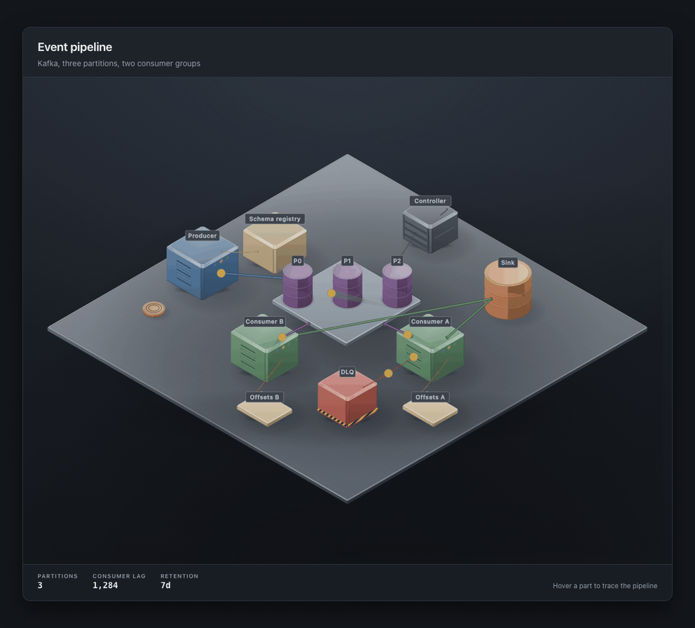
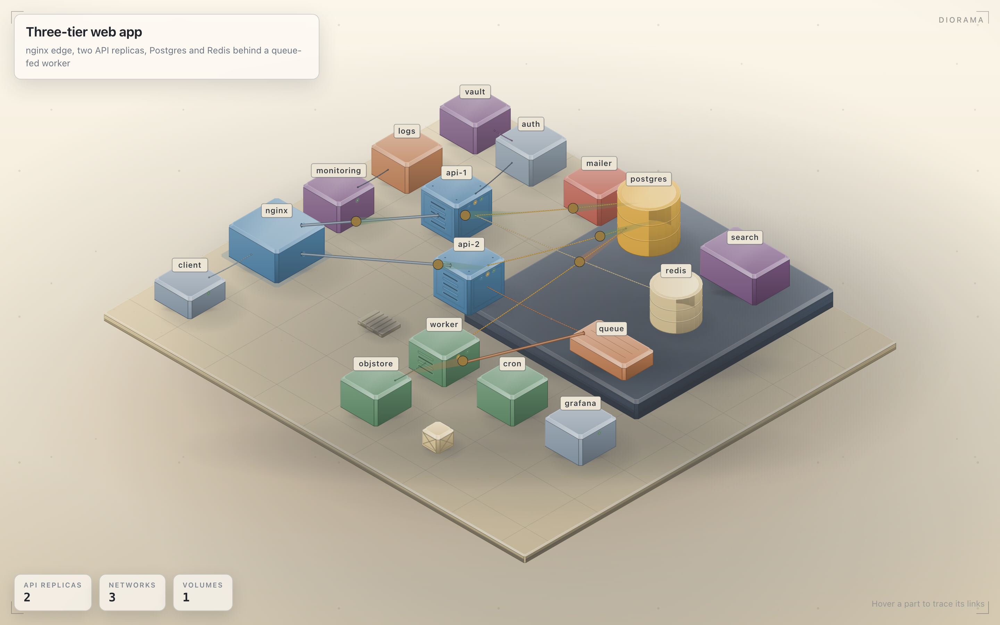
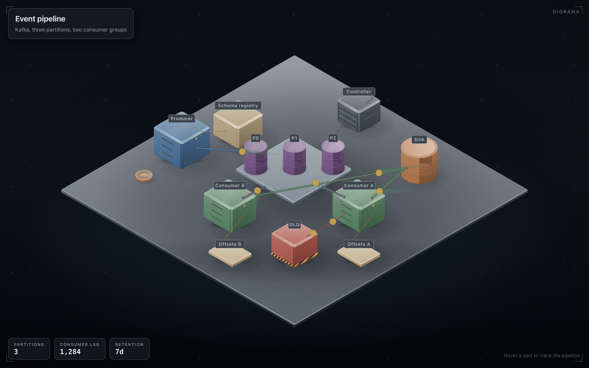
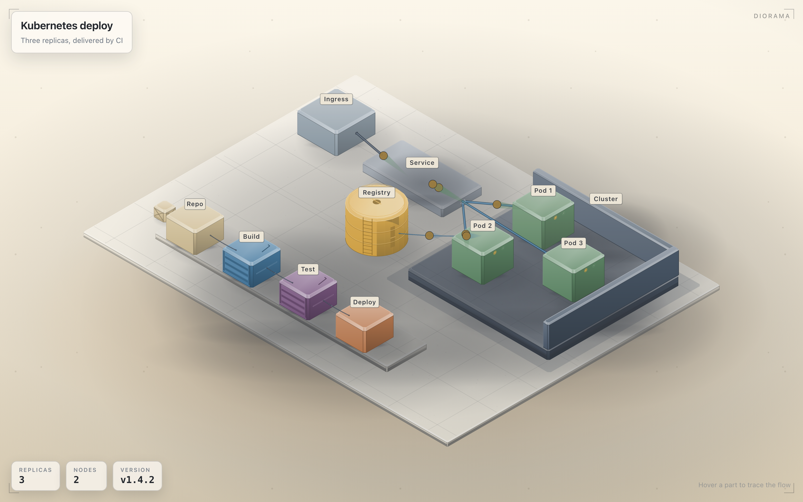

# Diorama

A Claude skill that turns a software system into a living isometric figure — SVG, animated flows and a real geometry audit — for docs, READMEs, blog posts and landing pages.

<p>
  <a href="https://github.com/nievesjesus/diorama/actions/workflows/ci.yml"></a>
  <a href="https://code.claude.com/docs/en/skills"></a>
  <a href="https://agentskills.io"></a>
  <a href="LICENSE"></a>
  <a href="#requirements"></a>
  <a href="#requirements"></a>
</p>



## Why

Almost every architecture diagram is a box with a label, and it drifts from the system the moment someone renames a service. Diorama draws the system you actually have: it reads a real config or a plain description and invents an isometric scene from the architecture facts in it, so the figure is specific to your services instead of generic clip art. Flows move calmly enough to read, the output is a single self-contained HTML file, and the geometry is checked mechanically before you ever paste it into a README. There is nothing to install and nothing to wire up.

## Gallery

[](examples/three-tier-web/index.html)

[](examples/kafka-pipeline/index.html)

[](examples/k8s-ci/index.html)

Every page is a full-bleed animated world in one self-contained HTML file; open one, hover to trace links, append `?t=2.5` to freeze a frame, `?frame=1` for a framed embed.

## Install

```sh
npx skills add nievesjesus/diorama -g -a claude-code
```

That installs the skill for your user at `~/.claude/skills/diorama`. Without the skills CLI, clone the repository straight into that folder:

```sh
git clone https://github.com/nievesjesus/diorama.git ~/.claude/skills/diorama
```

## Usage

In Claude Code, type `/diorama` and say what to draw:

```text
/diorama diagram this docker-compose
```

Or draft a scene straight from a compose file, outside the skill:

```sh
node scripts/from-compose.mjs docker-compose.yml --out scene.json && node build.mjs scene.json --audit
```

A first draft in one command; refine the scene by hand for gallery quality.

More prompts:

```text
/diorama draw our kafka event pipeline: a producer publishes to a topic with three partitions, a stream processor consumes it, and the result lands in a sink. dark theme.
```

```text
/diorama make an isometric figure of our kubernetes deployment and the CI pipeline that ships it, with the CI steps connected by cables, for the README.
```

```text
/diorama turn this nginx, api and postgres stack into a diagram with requests flowing through it. light theme, standalone HTML.
```

## How it works

- **Scene spec v1 (JSON).** A compact, deterministic description of parts, links, flows and readouts. You can write it by hand or let Claude derive it from a real config or a plain description.
- **Isometric kit.** Projects the scene into a 2:1 isometric SVG, paints solids back to front with a fixed four-tone material palette, and wires parts together with tubes and cables.
- **Standalone HTML.** Emits one portable file with no external assets. Append `?t=<seconds>` to the URL to seek and freeze the animation on an exact frame, or `?frame=1` for a framed embed.
- **Geometry audit and capture.** `--audit` proves nothing overlaps or floats, and headless capture verifies the rendered page frame by frame.

## Requirements

| | Needed for | Notes |
|---|---|---|
| **Node.js 20.10+** | builds, kit, checks | Built-in modules only: nothing to `npm install`. |
| **Chrome or Chromium** | the checks | Used headless by the capture and audit scripts. |

The kit has zero dependencies. Every script imports from `node:` builtins and nothing else, and no step reaches the network.

## Limits

- **It draws systems and machines, not people or maps.** A scene needs real parts and real connections; an idea with no mechanism to it will come out weaker.
- **It is slow on purpose.** A figure takes a real session: name the parts, lay out the world, build the geometry, run the audit and check the capture. That is the price of a figure that holds up in a README.
- **React output is roadmap.** Today the deliverable is a standalone HTML file; framework components are not shipped yet.

## Repository layout

```text
diorama/
├── SKILL.md                  the skill: workflow and house rules
├── build.mjs                 scene spec in, standalone HTML out
├── kit/
│   ├── iso.mjs               isometric camera, solids, palette, SVG renderer
│   ├── iso.css               the world chrome and HUD, both themes, reduced motion
│   ├── scene.mjs             scene spec v1 parsing and normalization
│   ├── motion.mjs            flow animation and seek
│   └── audit.mjs             the geometry audit
├── scripts/
│   ├── build-examples.mjs    rebuild every example
│   ├── capture.mjs           headless screenshots with zoom and time seek
│   └── from-compose.mjs      docker-compose to a first-draft scene spec
├── references/
│   ├── craft.md              how to compose a figure worth shipping
│   ├── verify.md             what to check before publishing
│   └── compose.md            drafting a scene from docker-compose
├── examples/                 three scenes, each scene.json + index.html + index.svg
├── evals/evals.json          test prompts and what a good answer contains
├── .github/
│   ├── workflows/ci.yml      tests, build and audit on every change
│   └── assets/               gallery screenshots and the hero GIF
├── KIT.md                    the kit API reference
├── package.json
├── LICENSE  README.md  CONTRIBUTING.md  CHANGELOG.md  SECURITY.md
```

## License

[MIT](LICENSE) © 2026 Jesus Nieves · [@nievesjesus](https://github.com/nievesjesus)
